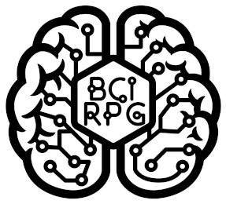

# BCI RPG

## Brain-Computer Interface Role-Playing Game
### Electronic Role-playing Game (ERPG) development efforts by the RPG Research community

...
...

# Brain-Computer Interface Controlled Role-Playing Games
...
...

# Introduction
RPG Research is a huge advocate for accessibility and inclusiveness in gaming. We do this not only through our training, advocacy, and accessible mobile facilities, but also through active projects that make gaming accessible to all. RPG Research is a 100% volunteer-run 501(c)(3) non-profit charitable research and human services organization. [More about RPG Research](https://www.rpgresearch.com).

Main website: www.bcirpg.com - alias: https://www.rpgresearch.com/bcirpg

The opensource GitHub repository: https://github.com/RPG-Research/bcirpg

The project Wiki: https://github.com/RPG-Research/bcirpg/wiki

# Background History
RPG Research's founder, Hawke Robinson, first got involved with role-playing games in 1977 and began software development around 1978. He joined the online community in 1979, through the early pre-Internet ARPANET, dial-up access via the University of Utah, and various BBSes.

He has worked with VR equipment and software on and off since the late 1980s, starting with Amigas (he still has a working Amiga 2000), and developed Virtual Reality Modeling Language (VRML) websites in the mid-to-late 1990s.

In the late 1990s and early 2000s, he experimented with early VR and AR on PDAs and "smartphones" (Nokia, Palm, etc.) long before iOS and Android existed, combined with early location and GPS technologies.

He has experimented with biofeedback and bio-controlled devices since 1996, such as a mouse cursor controlled by a single fingertip clip.

Since about 2005, he has worked on integrating electroencephalogram (EEG) and, later, brain-computer interface (BCI) equipment with computers, mobile devices, VR, and AR, including for educational, artistic, social, and therapeutic programs.

# LIS & CLIS - Locked In Syndrome and Complete Locked in State
Our founder was dramatically motivated to try to find a solution for those people suffering from Locked-in Syndrome (LIS) and Complete Locked-in State (CLIS), starting with caring for a young adult in 1990 as a nurse's aide and LPN trainee, at Doxie Hatch Medical Center, and additionally for many others with various injuries and neurological disorders as a habilitation therapist at Hillcrest Care Center.  Ever since, he has wanted to find a way to use technology to help them reconnect socially, free their active minds from the prisons of their bodies, and regain some of their lives.

The goal, and the real-world test of success, is whether someone with profound disabilities, including locked-in syndrome (LIS) or complete locked-in state (CLIS), can engage socially in complex, multiplayer, cooperative problem-solving role-playing games.

Program phases and updates on our live streams and GitHub: https://github.com/RPG-Research/

# Ultimate in RPG Accessibility and Immersion 
The greatest potential for accessibility lies in brain-computer interface (BCI) technologies based on electroencephalography (EEG). Integrated with AR and VR, and eventually with robotics in the physical world, they let a person control computer systems with their thoughts alone.

Linked with haptics, robotics, AR, VR, and other technologies, BCI also offers the potential for the ultimate immersive experience.

We have been hard at work experimenting with EEG and BCI equipment with music and RPGs since 2004.

Since 2019 our research and development team have been working on Project Ilmatar - https://github.com/RPG-Research/bcirpg/wiki - an opensource, online, multiplayer, turn-based, cooperative-play, electronic, role-playing game designed from the ground up for maximal accessibility including BCI control support.

Update Fall 2020, migrated to organization GitHub, moving our content from the previous individual Git: https://github.com/RPG-Research

As usual, our projects are little-known, long-running, and have almost no funding. It is thanks to our wonderful volunteers worldwide that we accomplish anything. We hope some day perhaps to have more support financially, but for now we keep leading in innovations thanks to the wonderful efforts of these generous people helping a few hours every week, and we share openly with the world in the truest form of opensource, following our philosophy of "the rising tide of shared knowledge floats all boats" to help improve the human condition globally.

While the software is free, the hardware we have to purchase to realize this technology fully is expensive. We are currently utilizing OpenBCI which still costs from hundreds to even thousands of dollars per headset. The RPG Research board approved $2,500 USD to purchase the full R&D bundle from OpenBCI. We are now working from two directions, software and hardware, toward full integration.

We also hope to loop back from the virtual world and integrate robotic devices controlled through BCI equipment to enable participants with disabilities to more fully engage in all role-playing game formats.

We stream the development meetings live each week on Saturdays from 10 am to Noon PST8PDT: https://youtube.com/rpgresearch 

If you miss the live stream, Patreon supporters get access to the recorded videos at least a month before the general public as a thank you for their donation support.  https://patreon.com/rpgresearch

# High-level Roadmap Development Phases

## Phase 0 - EEG I/O controllers in NWN on Linux
Learn basics of EEG, bio-and-neuro feedback, and computer interaction, then attempt to replace regular keyboard or other I/O controls for PC-based video game (preferably on Linux due to more flexibility of I/O controls) and play game with only EEG and/or bio-monitoring inputs. Start with NeverWinter Nights on Linux. - COMPLETE

## Phase 1 - Game design prototype in NWN:EE on Linux with EEG/BCI for I/O
Train the new development team in game development concepts by prototyping with the NWN Aurora Toolset. Create a new adventure module, based on Shakespeare's The Tempest, to serve as a test bed for future prototypes. Experiment with controls using EEG and BCI equipment with the Enhanced Edition Neverwinter Nights on Linux.   COMPLETE.

## Phase 2 - Game from scratch TUI version BCI I/O online turn-based multiplayer
Create from scratch a text-only multiplayer online turn-based cooperative RPG that can be played with only OpenBCI (or similar) equipment. - Currently nearing end of design and documentation steps, and starting actual coding steps. The GM tools will have a graphical interface built with the Godot engine, but gameplay must be entirely text-based (TUI) and playable with the simple inputs OpenBCI provides. Use the same adventure blueprint as Phase 1. Begin incorporating components from the AI RPG and AI GM (ai-rpg.com) projects as needed, especially for NPCs/Creatures, but also options for PCs, world sociopolitical, events, ripple effects from PC actions, etc.- CURRENTLY IN ACTIVE DEVELOPMENT. 

## Phase 3 - Add GUI
On top of the existing text-based game, add basic real-time graphics or pre-recorded action videos triggered by game events, like Dirk the Daring in Dragon's Lair.
August 2021: The GUI development has begun for the GM, adventure module, content creation, and server administrator tools. Players will keep the text interface for now.

## Phase 4 - Add VR
Add VR option to the graphical interface.

## Phase 5 - Add AR+
Add AR, GPS, global world location play to game. If viable include "holographic" UI options so no glasses, etc. required.

## Phase 6 + Add Physical local realm interaction
Extend the BCI tools into the physical world through robotics and wireless triggers, combining AR with physical devices: dice-rolling machines, robotic arms that pick up and move objects, and miniatures moved around the table and enhanced by AR animation. That way, people with LIS/CLIS can play at the same physical table, or LARP, with other players, not just online.

# Phase 0 (completed) 2006 - 2014 OpenEEG
NeverWinter Nights (NWN) Diamond Edition on Linux controlled by OpenEEG equipment.

Basic control of PC movement. Routing of I/O through OpenEEG 5 channel headset.

Began 2006, functional by 2010, stopped working on it by 2014. 

Very rudimentary movement, and on/off menu (or other on/off assigned hotkey) mapped and working. Not sufficient for LIS/CLIS, but helpful for some disabilities. Very high latency and error rate however.

This needs higher signal resolution, wider frequency ranges, and more CPU power. OpenEEG and consumer hardware were getting closer but still fell short, and were not sufficient for adding AR/VR.

# Phase 1 (completed) 2019 - 2020
NeverWinter Nights (NWN) Enhanced Edition (NWN:EE).

Using Windows for Aurora Toolset module development.

Not using EEG or BCI equipment at this phase. Creating prototype adventure that will be used in Phase 2 onward for baseline R&D.

Used the NWN:EE Aurora Toolset to create a custom adventure, both for development prototyping and for team training and team building. Began August 2019, completed August 2020 successfully (still adding enhancements over time). Later see if newer generation OpenBCI can be used.

# Phase 1b - (in-progress) - OpenBCI
Is it possible to configure OpenBCI to run this game at, or better than, OpenEEG did for NWN Diamond Edition in Phase 0? - Yes.

It is not expected that full functionality, or multiplayer features will work. But hoping that the 16-channel higher quality setup may make solo play viable. - Yes, especially if taking menu-driven approach rather than free-range movement approach (at least initially).

# Phase 2 (in-progress) 2020 - Current
Scope and build from ground-up electronic role-playing game (ERPG) that can be controlled by accessibility equipment, especially newer generation EEG/BCI equipment, such as the OpenBCI hardware (among others).

## OpenBCI
...

## Godot
...

## Text-based UI (TUI)
...

## Brain-computer Interface controlled text-only turn-based menu-driven.
...

### BCI RPG Game player, Player Text User Interface

 

# Features Scope

Electronic role-playing game that can be played with many different adaptive devices but MUST be fully playable (without chat) using only the human brain of the player(s) (BCI). Ultimately must be playable by LIS/CLIS population.

## BCI-controlled

## Online
...

## Multi-player
...

## Cooperative Team-focused
...

## Turn-based
Turn-selection process in noncombat situations for online multi-player turn-based live real-time brain-computer interface controlled role-playing game.

## Initially text-only - Later add GUI, AR, VR, and Robotic interfaces
...

## Cross-platform

At a minimum must be playable on:
 * Linux
 * Windows
 * Mac
 * Online web browser
 * Android

Nice-to-haves but not required:
 * iOS
 * Consoles
 * AR devices
 * VR devices

## Menu-driven

Due to the goal of being playable by LIS/CLIS participants purely through BCI, and since BCI text pick lists are so slow, the game needs to be BCI menu-driven, rather than typed text or keyboard controller driven.
A BCI text pick list feature can be added later for chatroom functionality if someone wants to take on adding that feature at some point.

## Non-QWERTY-chat-based social interaction
(use other chat solutions as needed)
(not a MUD/MUSH/MOO)

## Use the [matrix]?

Potentially using Matrix-synapse as underlying network communication infrastructure, especially for chat

## Opensource

# HISTORY

Began scoping Phase 1 in August 2019; Phase 1 was completed in August 2020.

Meeting weekly (broadcast live).

Estimate this phase completion around August 2021 (potentially sooner if current development momentum maintained by team).

Supports Game Master (GM) tools to participate in the game in DM roles with the players during the live game.

Ability to pause game, save game, restore game.

Supports multiple genres (player selected).

Multiple underlying RPG systems (player selected).

Phase 2b Toolset provided for potential game master to create new adventures (does not need to meet BCI requirements for toolset).

Phase 2c - Replicate the NWN Tempest adventure using our Toolset to play in the BCI RPG (text-based play)

More scope details and full documents in Brain Computer Interface Role-Playing Game BCI RPG Github repository.

## PC / NPC interaction dialog menus for BCI RPG text-based wireframe and example flow

## d20 RPG extended conflict overview flowchart. Included Dungeons & Dragons 5th edition (D&D 5e), and open d20 variants.

## General UI for BCI RPG

## Server Management GUI
This assumes players may have LIS/CLIS, but that the GM, therapist, or server administrator can use a full graphical interface.

## Phase 2b - Develop Module Creation Tools with UI (in-progress)
The module creation toolset is not designed for BCI or LIS/CLIS users. The assumption is that Game Master / Dungeon Master, Educator, or Therapist will use this toolset to create new custom adventures (like the Aurora Toolset is used to create adventures for NWN).

This requires full graphical tools at this point. We would love to eventually create a BCI-controlled toolset, but that is beyond what our current team is ready for. We hope to circle back to it.

# Phase 2c - Create Tempest Adventure Using New Custom-built Toolset (pending)
In Phase 2 all the basic play mechanics, and the module creation tools are built.

# Phase 3 (in-progress August 2021)
Add graphical interface (instead of just text interface) with audio and video pre-recorded events tied into the text-based events (a la Dragon's Lair). Later add more dynamic graphics/audio/video for smoother experience. Early hooks were planned to begin around late 2021.

# Phase 4 (pending)
Add VR integration, motion integration, while still fully supporting BCI play. Include accessibility settings for VR for people with very limited or no physical mobility of their own (various drivers from third-parties hopefully to integrate, do not want to have to develop those drivers ourselves).

# Phase 5 (pending)
Add AR integration, GPS integration, with mobile devices and headsets, while still fully supporting full BCI play.

# Phase 6 (pending)
Bring accessibility BCI RPG back to the tabletop.

integrate robotics equipment controlled through the BCI controls of the game play

enable rolling physical dice

moving physical miniatures

Integrate "holographic" experiences with robotics, AR, etc.

and other features through the BCI control

All of this happens in a tabletop (TRPG) setting rather than an online ERPG, using the tools and code built for the ERPG to enable tabletop play.

Your donations mean that more people can have access to our free programs.

Please [donate](https://www.rpgresearch.com/donate) to help us with these efforts.

 

